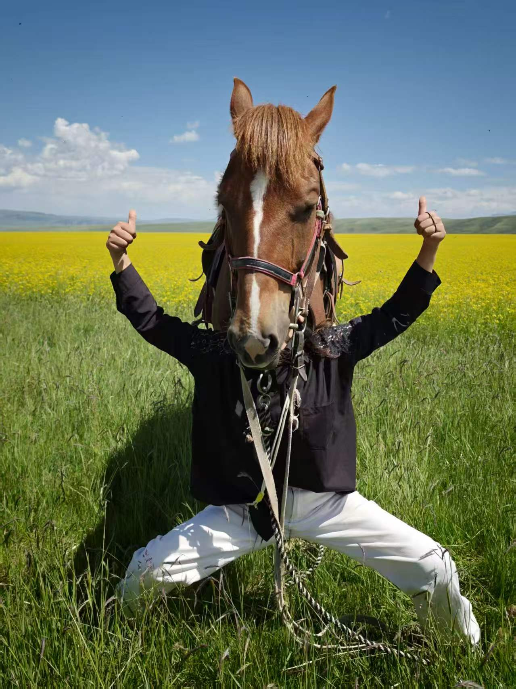
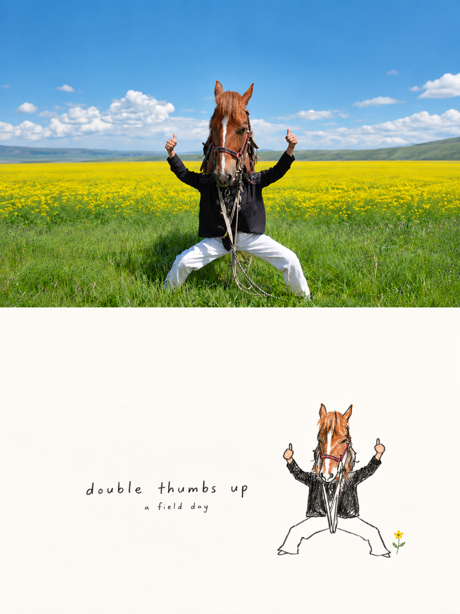
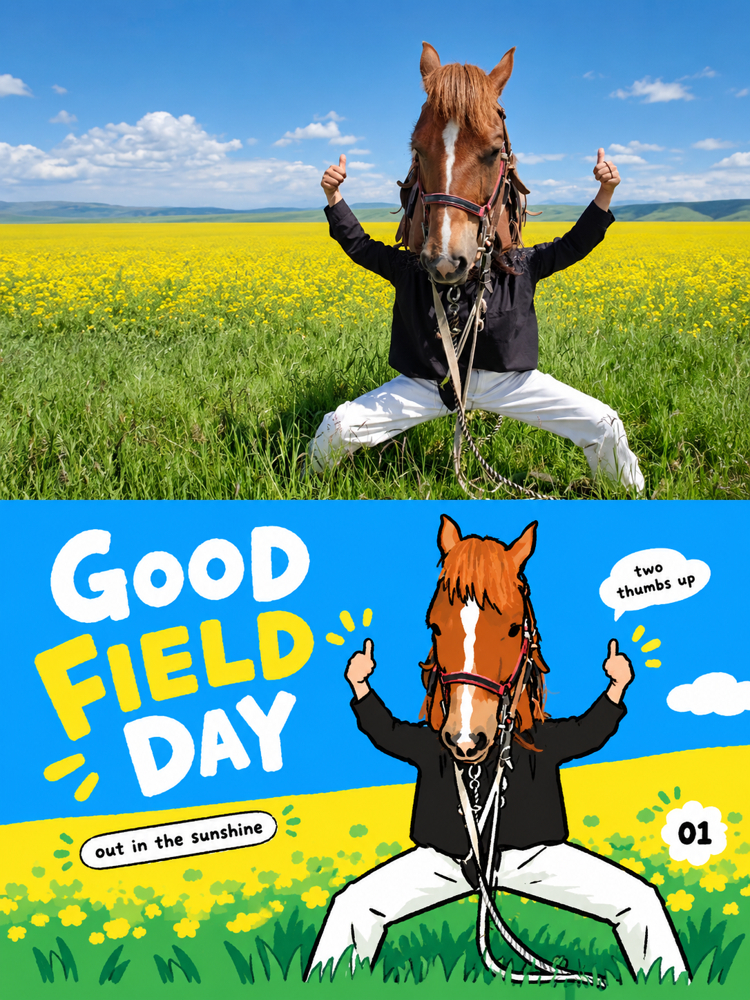

# Creative Skills

可复用的创意类 Agent Skills，面向支持 `SKILL.md` 的助手。

## 当前技能

| Skill | 用途 |
| --- | --- |
| [photo-doodle-poster](skills/photo-doodle-poster/SKILL.md) | 每张照片生成一张 3:4 海报：上半照片，下半少色极简手绘；上下等分，主体完整，大量留白。 |
| [photo-korean-editorial-poster](skills/photo-korean-editorial-poster/SKILL.md) | 上半真实摄影，下半韩式平面编辑插图；鲜亮纯色、粗黑手绘轮廓、俏皮英文排版。 |
| [video-character-recast](skills/video-character-recast/SKILL.md) | 按参考视频逐镜头替换角色，保留表演与剪辑；支持分段提示词、结果核对和局部修复。 |

## 同一张照片，两种海报

用同一张“马头遮住人脸、双手点赞”的照片运行全部照片转换技能。两个技能均使用内置图像生成工具实际出图；视频角色替换不属于照片转换，不在本组演示范围。



| 少色极简手绘 | 韩式平面编辑插图 |
| --- | --- |
|  |  |
| 暖白留白、细小完整主体、松弛线条 | 蓝黄鲜色、明确视觉中心、粗黑轮廓与英文标题 |

[查看示例提示词、生成过程与检查记录](examples/horse-field/README.md)。图片是实际生成结果，不代表每次都能像素级保留原照片；扩展环境和精确分区仍需检查。

## 安装到 Codex

将本仓库下载或克隆后，将需要的 skill 文件夹复制到个人 skills 目录：

```bash
git clone https://github.com/liushuang216/creative-skills.git
mkdir -p ~/.codex/skills
cp -R creative-skills/skills/photo-doodle-poster ~/.codex/skills/
cp -R creative-skills/skills/photo-korean-editorial-poster ~/.codex/skills/
cp -R creative-skills/skills/video-character-recast ~/.codex/skills/
```

已有同名 skill 时，先比较内容，再决定是否替换。重新启动会话后调用：

```text
使用 $photo-doodle-poster，把这些照片分别做成独立海报。
```

鲜亮平面版本可调用：使用 $photo-korean-editorial-poster，把这张照片做成上半摄影、下半韩式平面插图的海报。

也可仅生成 prompt：

```text
使用 $photo-doodle-poster，为这张照片写一份无字版本的生成提示词。
```

需要生成图片时，运行环境须提供支持参考照片的图像编辑工具。只有文字能力的环境可以使用提示词模板。

视频角色替换示例：

```text
使用 $video-character-recast，把参考视频中的原角色 A 换成图片1，原角色 B 换成图片2。
保留镜头、动作与夸张表情，先给我逐镜头替换提示词。
```

也可提供生成结果，要求定位串角、身体朝向或动作问题并制作局部修复方案。技能本身不绑定视频生成平台；生成需要支持参考视频的工具，分段与拼接需要可用的媒体处理工具。付费生成与外部上传按当前任务授权执行。

## 设计原则

保留原始审美 prompt，并纳入实际迭代中的主体完整性修正。删减背景和细节，不误删主要主体的腿脚；靠缩小主体与扩展环境适配画幅。尺寸和分区仍需检查生成结果，文字约束不保证每次生成都精确满足。

技能目录包含通用说明与文本模板。examples/horse-field 另附用户明确授权用于公开演示的原图与生成结果；其他私人照片、会话文件和本地路径不纳入仓库。使用技能不代表授权公开新的输入照片。

视频技能来自实际角色替换工作流的抽象，重点是稳定身份映射、独立分段提示词、动作驱动的形变与按实际结果回填。模板中的时间线需根据当前视频观察填写，不保证仅靠文字即可精确控制生成帧率或切镜。

## License

技能代码与文档采用 MIT。示例原照片的权利归原权利人；公开展示授权不等于向第三方授予照片的 MIT 许可。
