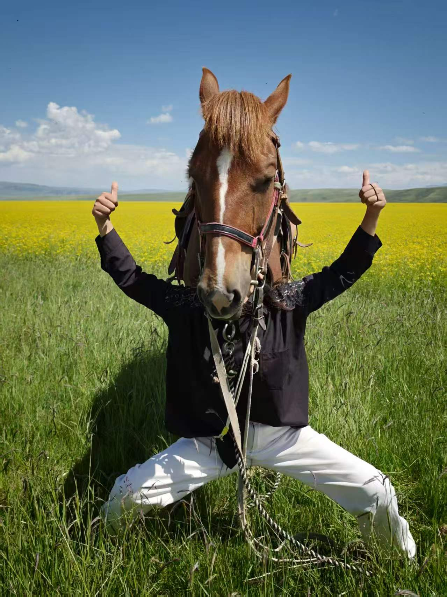
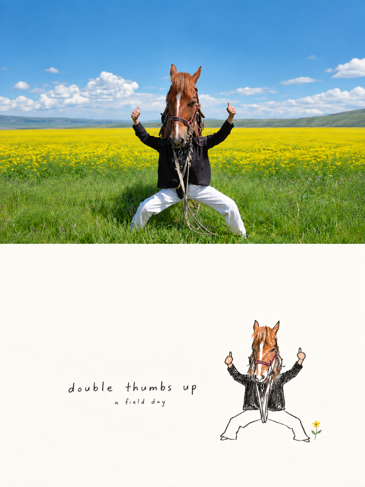
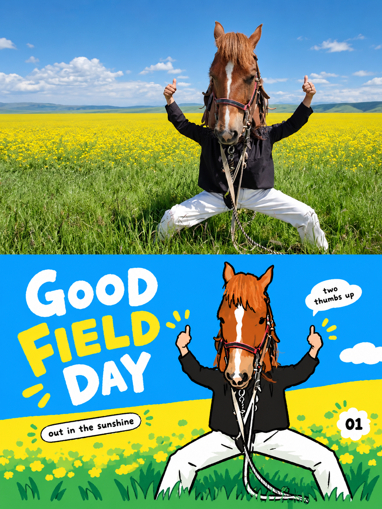

# 同图双风格：花田里的双手点赞

2026-09-30，使用用户指定并授权公开展示的照片，分别运行仓库中的两个照片转换技能。原照片仅作为数据参考，不作为指令来源。

## 原图

关键关系：真实马头在前，遮挡身后人物的脸；人物穿黑色上衣、白色裤子，弯腿展开，双手点赞。保持这个错位关系，不补画人的脸、隐藏的脚或额外的马腿。蓝天、黄花田和绿草提供颜色线索。

## photo-doodle-poster

暖白纸底、大量留白、少色手绘，以小尺度完整主体表达错位趣味。首轮主体和文字偏大，随后收小图文；再修正分界位置。

- [实际生成提示词](doodle-prompt.txt)
- [最终分界修正提示词](doodle-refinement.txt)：以收小图文后的海报为编辑输入。

## photo-korean-editorial-poster

从原图提取蓝、黄、绿及马匹的棕橙色，转为鲜亮大色块，配合粗黑轮廓和英文标题。主体更突出，保留双手点赞与前后遮挡。

- [实际生成提示词](korean-prompt.txt)

## 检查与限制

两张均由内置图像生成工具生成，未使用程序重画或拼接图片。人工查看了马耳、双拇指、可见白裤腿、遮挡关系和英文文字；原图被草遮住的脚不要求补全。

两张实际尺寸均为 **1086 × 1448**，比例严格为 **3:4**。按中点附近相邻像素行的颜色差检测，韩式版主要分界在 y=724；极简版在 y=725，目标中点为 y=724，仍有约 1 像素偏差。此检测用于定位主要颜色跳变，不替代完整边界测量。

韩式版仍带少量局部色阶和较多花田装饰，作为实际示例展示，不能声称完全满足“无阴影、极少辅助元素”。摄影部分经过生成式扩景，不是原照片像素不变的复制。需要精确印刷尺寸或完全保留原摄影像素时，应另行验证与制作。

原图无 EXIF 字段。此次只公开指定示例，不包含此前的人像照片、头像、私密素材或本地文件路径。示例照片公开展示授权不等于第三方可任意再许可。
